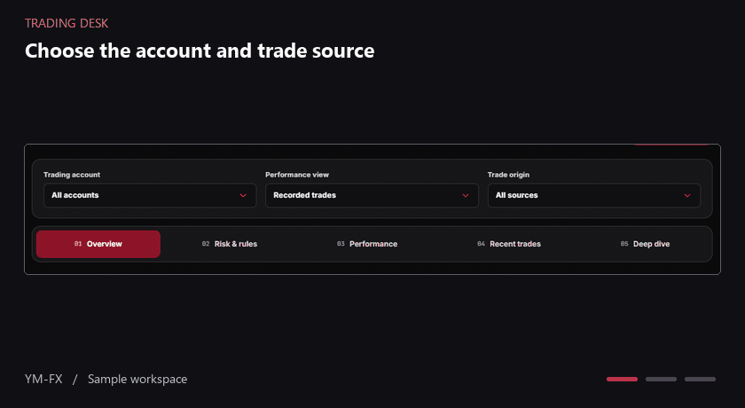

# YM-FX · Trading journal and MT5 connector


YoungMoney3 gives a trader a way to answer a question after a position closes: **Did I follow the plan I had when I opened it?** The dashboard brings the entry plan, broker fills, screenshots and review notes together. The Windows connector can collect execution history while the trader works from the dashboard on a phone or PC.

[Open the invite-only staging dashboard](https://ym-fx-staging.ethical-hacker263.workers.dev/) · [Windows downloads](https://github.com/cash-factory/YoungMoney3/releases) · [Local setup](#run-the-dashboard-locally) · [Validation runs](https://github.com/cash-factory/YoungMoney3/actions/workflows/validate.yml)

## Inside the workspace

| Trading desk | Media library |
| --- | --- |
| [](docs/assets/screenshots/dashboard.png) | [](docs/assets/screenshots/media-library.png) |
| Review the account, record a decision and return to unfinished work. | Open the chart or voice note attached to an entry or close. |

These application captures use synthetic records. Select either image for a full-size view.

<details>
<summary>Watch the nine-second dashboard and media walkthrough</summary>



[Open the walkthrough at full size](docs/assets/screenshots/journal-walkthrough.gif)

</details>

### From plan to review

1. **Before entry** — Choose the account, strategy and setup. Record the entry criteria, initial risk and checklist in the dashboard.
2. **During the position** — Log a manual trade or pair a Windows PC in **MT5 Connections**. Check the account’s last successful sync. A PC can be online while its terminal is disconnected.
3. **After the close** — Review the position across its fills and partial closes. The journal preserves original broker evidence and records discrepancies separately. Later stop changes have their own history. An offline interval can leave gaps in the observed stop history.
4. **At the weekly review** — Compare the plan with the recorded decisions. Use Decision Replay and the Improvement Lab to turn an observation into an experiment you can evaluate on later trades.

## Choose a Windows connector

| | Windows connector | Signal Desk native preview |
| --- | --- | --- |
| Best starting point | Pair a PC, link accounts, capture history and manage monitoring. | Try the native Windows interface and its account discovery workflow. |
| Link an account | From **MT5 Connections**, pair the PC, then use **Add account** and confirm the server, login and account timezone. | Use **Add MT5 Account**, sign in through the dedicated MT5 window, then use the dashboard to scan the paired PC and select the account to monitor. |
| Copy Studio | Separate from journal capture. Execution depends on deployment settings, local follower consent and the fleet’s armed state. | This shell exposes monitoring and session management. Order submission is unavailable here. |
| Install and troubleshoot | [Windows connector guide](connector/README.md) | [Signal Desk guide and build instructions](connector/desktop/README.md) |

Both tracks use a Windows PC with MT5 for broker connectivity. Compare the downloaded executable’s SHA-256 with its matching release checksum. For an existing pairing, reopen the connector under the same Windows user so it can reuse credentials and pending uploads.

**After a disconnect**, reconnect the same dedicated terminal and inspect the last acknowledged account sync. Reconcile positions that closed while offline, partial fills, costs and the original protective stop against the broker statement. The [release acceptance matrix](docs/release-acceptance-matrix.md) and [Copy Studio pilot guide](docs/LIVE_COPY_PILOT.md) cover the checks that require broker access.

## Run the dashboard locally

Use Node.js 22.18+ on the 22.x line and Python 3.13 for the connector packaging step. The default branch contains the dashboard, Worker and connector sources.

```sh
git clone https://github.com/cash-factory/YoungMoney3.git
cd YoungMoney3
npm ci
npm run build
npm run cf:migrate:local
```

Start the local API in one terminal. Use a development-only invite code.

```sh
npm run cf:dev -- --local --var PILOT_INVITE_CODE:local-demo-invite
```

In a second terminal, start the frontend and open **http://localhost:5173**. Vite forwards `/api` to the local Worker on port 8787.

```sh
npm run dev
```

The build generates the downloadable connector source ZIP from the checked-in Python modules. Private media uploads require a configured storage backend. [Storage and environment setup](docs/OPERATIONS.md)

## Verify a change

| Area | Command or check |
| --- | --- |
| Types and lint | `npm run typecheck` and `npm run lint` |
| Journal calculations and domain rules | `npm test` |
| UI contracts and broker search | `npm run test:ui` |
| Worker, account isolation and Copy Studio | `npm run test:worker` |
| Staging configuration | `npm run test:staging` |
| Shipped connector source | `npm run build`, then `python scripts/test-connector-archive.py --check-dist` |
| Windows connector engine | On Windows x64 with Python 3.13, install `connector/requirements.txt`, then run `python -m unittest discover -s connector -p "test_*.py"` |
| Rendered workflows | [Dashboard browser checks](.github/workflows/platform-visual.yml) and [Signal Desk browser, bridge and installer checks](.github/workflows/connector-signaldesk-native.yml) |

## Repository map

| Path | What lives here |
| --- | --- |
| [src/](src/) | React and TypeScript dashboard, page routes, shared controls and journal calculations |
| [worker/](worker/) · [migrations/](migrations/) | Same-origin Cloudflare API, account access, capture ingestion and ordered D1 schema changes |
| [connector/](connector/) · [connector/desktop/](connector/desktop/) | Python MT5 engine, local evidence store and native Tauri shell |
| [scripts/](scripts/) · [.github/workflows/](.github/workflows/) | Source packaging, validation, browser checks and release workflows |
| [docs/references/trading-plan/](docs/references/trading-plan/) | Photon plan references and the original Notion template export |
| [docs/ASSETS.md](docs/ASSETS.md) | Brand artwork, interface illustrations, screenshots and credits |

[Architecture](docs/ARCHITECTURE.md) · [Administration](docs/ADMIN_OPERATIONS.md) · [Backup and recovery](docs/BACKUP_RECOVERY.md) · [Release procedures](docs/STAGING_RELEASE.md)
