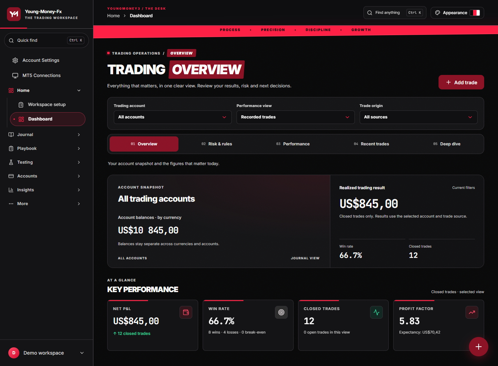
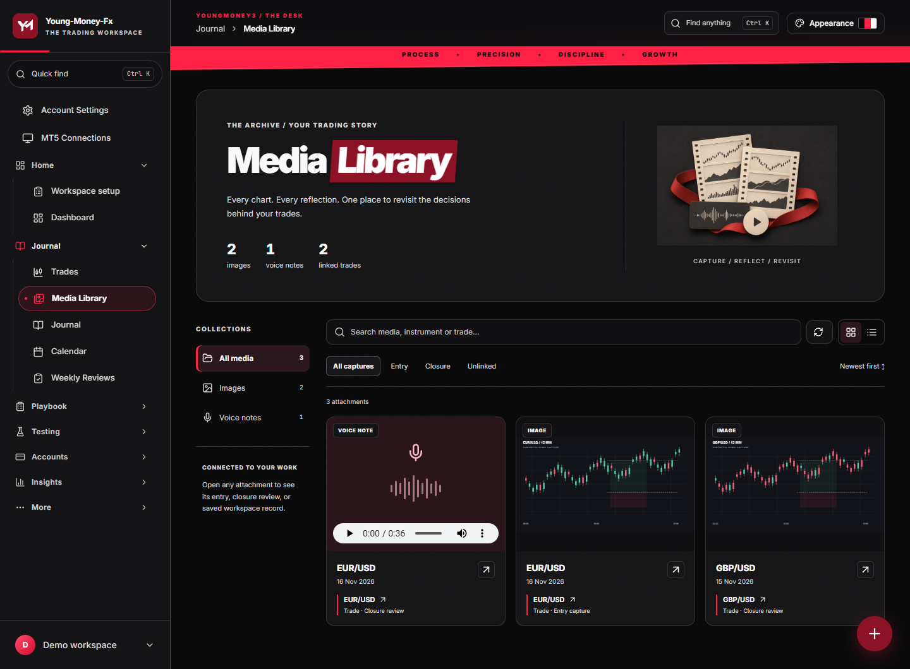

<p align="center">
  
</p>

<p align="center">
  A focused workspace for planning trades, capturing execution and turning reviews into a better process.
</p>

<p align="center">
  <a href="https://ym-fx-staging.ethical-hacker263.workers.dev/"><strong>Explore staging ↗</strong></a> &nbsp; · &nbsp;
  <a href="https://github.com/cash-factory/YoungMoney3/tree/feat/rich-capture-staging-20261110">Current app source</a> &nbsp; · &nbsp;
  <a href="docs/ASSETS.md">Brand &amp; assets</a> &nbsp; · &nbsp;
  <a href="docs/USER_GUIDES.md">Interactive guides</a> &nbsp; · &nbsp;
  <a href="#run-locally">Run locally</a>
</p>

> **Current preview:** the screenshots and feature tour reflect the staging branch. Production promotion is a separate release step.

## One workspace. A complete trading process.

| Plan with intent | Capture with context | Review with clarity |
| :--- | :--- | :--- |
| Trading plans, strategies, entry models and setup checklists. | Manual trades, account context and a read-only Windows MT5 connector. | Focused dashboard sections, performance analysis and weekly reflections. |
| Account-specific risk rules and progress goals. | Screenshots and voice notes linked to entry and closure. | A searchable Media Library, trading calendar and journal. |

The **CraftyLabs-inspired** visual system brings editorial typography, clean page-specific layouts and restrained motion to **12 color palettes**, each with light and dark modes. Keyboard navigation and reduced-motion preferences are supported.

<table>
  <tr>
    <td width="50%"><a href="docs/assets/screenshots/dashboard.png"></a></td>
    <td width="50%"><a href="docs/assets/screenshots/media-library.png"></a></td>
  </tr>
  <tr><td align="center"><strong>Your desk, one focus at a time.</strong></td><td align="center"><strong>Every capture, connected to its trade.</strong></td></tr>
</table>

<sub>Actual application screens with synthetic demo records. Click a screen to view it at full size.</sub>

## Built for a connected workflow

**React + TypeScript + Vite + Tailwind CSS** power the interface. A **Cloudflare Worker** serves the app and same-origin API; **D1** stores workspace records. Private images and audio use **Supabase Storage**, with legacy **R2** support. The optional **Python / MetaTrader 5** connector runs on Windows and captures broker execution without placing orders.

## Run locally

Use **Node.js 22+**. The latest interface lives on the staging branch:

<details>
<summary><strong>Open the API + frontend setup</strong></summary>

```sh
git clone --branch feat/rich-capture-staging-20261110 https://github.com/cash-factory/YoungMoney3.git
cd YoungMoney3
npm ci
npm run build
npm run cf:migrate:local
```

Start the local API and frontend in two terminals:

```sh
# Terminal 1 — local Worker and test database
npm run cf:dev -- --local --var PILOT_INVITE_CODE:local-demo-invite

# Terminal 2 — frontend at http://localhost:5173
npm run dev
```

Private uploads need storage configuration; the Windows connector has its own [setup guide](https://github.com/cash-factory/YoungMoney3/blob/feat/rich-capture-staging-20261110/connector/README.md). See [Operations](docs/OPERATIONS.md) for environment setup and [Staging release](docs/STAGING_RELEASE.md) for deployment.

</details>

<details>
<summary><strong>Checks and project map</strong></summary>

```text
React workspace ── same-origin API ── Cloudflare Worker ── D1
                                           ├── Private media storage
Windows MT5 connector ── paired HTTPS ──────┘
```

```sh
npm run typecheck
npm run lint
npm test
npm run test:ui
npm run test:staging
npm run test:worker
npm run build
```

| Path | Purpose |
| :--- | :--- |
| `src/` | Pages, shared controls, themes and domain logic |
| `worker/` · `migrations/` | API, authentication and D1 schema |
| `connector/` | Windows MT5 capture and session management |
| `public/visuals/` | Runtime logo and illustration assets |
| `docs/assets/` | README banner, brand exports and demo screenshots |
| `docs/` | Architecture, operations, release and recovery guides |

The staging UI is covered by page/theme checks and dashboard, dropdown, media and motion regressions. [Browse CI runs](https://github.com/cash-factory/YoungMoney3/actions).

</details>

## Go deeper

[Architecture](docs/ARCHITECTURE.md) · [Operations](docs/OPERATIONS.md) · [Backup & recovery](docs/BACKUP_RECOVERY.md) · [Release readiness](docs/PRODUCTION_READINESS.md) · [Asset catalogue & credits](docs/ASSETS.md) · [Logo directions](docs/LOGO_DIRECTIONS.md)

Implementation references: [React](https://react.dev/) · [TypeScript](https://www.typescriptlang.org/docs/) · [Vite](https://vite.dev/) · [Cloudflare Workers](https://developers.cloudflare.com/workers/) / [D1](https://developers.cloudflare.com/d1/) · [Supabase Storage](https://supabase.com/docs/guides/storage) · [MT5 Python API](https://www.mql5.com/en/docs/python_metatrader5)

<p align="center"><sub>Plan deliberately. Capture honestly. Review consistently.</sub></p>
